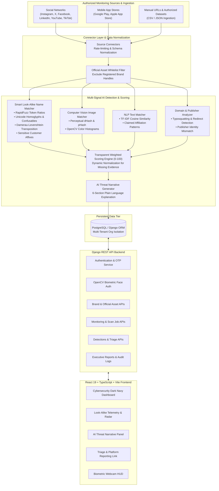

# BrandShield AI — Digital Risk Protection Platform
### AI-Powered Social & Mobile Application Impersonation Defense

BrandShield AI is an enterprise-grade Digital Risk Protection (DRP) and cybersecurity intelligence platform designed to proactively detect, investigate, prioritize, and remediate potential brand impersonation threats across global social networks and mobile application storefronts.

---

## 1. Application Architecture Diagram



---

## 2. Technology Stack

### Frontend:
- **Framework**: React 19 with Vite
- **Language**: TypeScript
- **Styling**: Tailwind CSS v4 with custom cybersecurity dark navy, teal, and blue palette
- **Data Visualization**: Recharts (Detection trends, platform distributions, threat ecosystem ratios)
- **Routing**: React Router DOM v7
- **HTTP Client**: Axios with JWT interceptors
- **Icons**: Lucide React

### Backend:
- **Runtime**: Python 3.12+
- **Framework**: Django & Django REST Framework (DRF)
- **Authentication**: Custom AbstractUser, salted OTP verification, and JWT (SimpleJWT)
- **Database**: PostgreSQL (with automatic zero-config SQLite development fallback)
- **Security**: PBKDF2/Argon2 password hashes, salted SHA-256 OTP hashes, encrypted biometric descriptors

### AI & Risk Detection:
- **Smart Look-Alike Name Matcher**: `RapidFuzz`, Unicode NFKD confusable homoglyph translation, Damerau-Levenshtein transposition detection, affix extraction
- **Logo & Icon Computer Vision**: `imagehash` (dHash, pHash) and `OpenCV` (`cv2`) 2D color histogram correlation
- **NLP Text & Bio Similarity**: `scikit-learn` `TfidfVectorizer` + Cosine Similarity + affiliation regex patterns
- **AI Threat Explanations**: 6-section human-readable threat explainer with optional LLM integration (OpenAI/Gemini/Anthropic) and deterministic fallback

---

## 3. Project Directory Structure

```text
TrustShiedAI/
├── docker-compose.yml
├── README.md
├── backend/
│   ├── brandshield/
│   │   ├── settings.py          # Database, JWT, CORS, Security configs
│   │   ├── urls.py              # Root routing
│   │   ├── utils.py             # Global exception handler
│   │   └── wsgi.py
│   ├── accounts/                # Users, Orgs, OTP, Face Auth, Audit Logs
│   │   ├── models.py
│   │   ├── services.py          # OTPService, FaceAuthService (OpenCV)
│   │   ├── serializers.py
│   │   ├── views.py
│   │   ├── urls.py
│   │   ├── tests.py             # Automated security tests
│   │   └── management/commands/seed_demo_data.py
│   ├── brands/                  # Brand profiles & Whitelisted official assets
│   │   ├── models.py
│   │   ├── serializers.py
│   │   ├── views.py
│   │   └── urls.py
│   ├── monitoring/              # Social & App store connectors & Scans
│   │   ├── models.py
│   │   ├── demo_dataset.py      # Rich synthetic candidate datasets
│   │   ├── pipeline.py          # End-to-end scanning orchestration
│   │   ├── serializers.py
│   │   ├── views.py
│   │   └── urls.py
│   ├── detection/               # Core AI & Detection modules
│   │   ├── lookalike.py         # Smart look-alike homoglyph/typo matcher
│   │   ├── image_matcher.py     # Perceptual hash & OpenCV matcher
│   │   ├── text_matcher.py      # TF-IDF cosine & bio NLP
│   │   ├── domain_analyzer.py   # Publisher & domain risk classifier
│   │   ├── scoring_engine.py    # Transparent weighted 0-100 scoring
│   │   ├── ai_explainer.py      # Human-readable threat narratives
│   │   └── tests.py             # 13+ automated detection unit tests
│   ├── investigations/          # Detections, Evidence items, Analyst notes
│   │   ├── models.py
│   │   ├── serializers.py
│   │   ├── views.py
│   │   └── urls.py
│   ├── reports/                 # Executive analytics, CSV export
│   │   ├── views.py
│   │   └── urls.py
│   ├── requirements.txt
│   ├── .env.example
│   └── manage.py
├── frontend/
│   ├── src/
│   │   ├── components/
│   │   │   ├── Sidebar.tsx      # Collapsible dark navy navigation
│   │   │   ├── Navbar.tsx       # Brand switcher & scan triggers
│   │   │   ├── SeverityBadge.tsx
│   │   │   └── CameraCaptureModal.tsx # Webcam biometric HUD
│   │   ├── context/
│   │   │   └── AuthContext.tsx
│   │   ├── pages/
│   │   │   ├── LandingPage.tsx
│   │   │   ├── LoginPage.tsx
│   │   │   ├── RegisterPage.tsx
│   │   │   ├── OtpVerifyPage.tsx
│   │   │   ├── ForgotPasswordPage.tsx
│   │   │   ├── DashboardPage.tsx
│   │   │   ├── BrandProfilesPage.tsx
│   │   │   ├── BrandDetailPage.tsx
│   │   │   ├── SocialMonitoringPage.tsx
│   │   │   ├── AppStoreMonitoringPage.tsx
│   │   │   ├── ThreatDetailsPage.tsx
│   │   │   ├── InvestigationsPage.tsx
│   │   │   ├── NotificationsPage.tsx
│   │   │   ├── ReportsPage.tsx
│   │   │   ├── DataSourceSettingsPage.tsx
│   │   │   ├── SettingsPage.tsx
│   │   │   └── HelpDocsPage.tsx
│   │   ├── services/            # Axios API wrappers
│   │   ├── types/               # TypeScript interfaces
│   │   ├── App.tsx              # Router configuration
│   │   ├── index.css            # Tailwind theme
│   │   └── main.tsx
│   ├── package.json
│   ├── vite.config.ts
│   └── .env.example
```

---

## 4. Quickstart Guide (Local Development)

### Prerequisites:
- Python 3.12+
- Node.js 18+ and npm

### Step 1: Backend Setup
```powershell
cd backend

# Install dependencies
python -m pip install -r requirements.txt

# Run database migrations
python manage.py migrate

# Seed initial demo analyst, AcmePay brand, assets, and candidate threats
python manage.py seed_demo_data

# Start the Django API server
python manage.py runserver 127.0.0.1:8000
```
Backend API will be live at: `http://127.0.0.1:8000/api/`

### Step 2: Frontend Setup
```powershell
cd frontend

# Install npm dependencies
npm install

# Start Vite development server
npm run dev
```
Frontend Web Application will be live at: `http://localhost:5173/`

---

## 5. Running Automated Unit Tests

Execute the automated test suite across authentication, look-alike detection, confusable homoglyphs, transpositions, risk scoring, and official asset exclusion:

```powershell
cd backend
python manage.py test
```
**Test Results:**
```text
Creating test database for alias 'default'...
.............
----------------------------------------------------------------------
Ran 13 tests in 4.715s

OK
```

---

## 6. Reviewer Demo Credentials & Quick Test Walkthrough

For rapid hackathon testing without configuring email SMTP or Twilio:

- **Email**: `analyst@brandshield.ai`
- **Password**: `BrandShield@2026!`
- **Quick Fill Pill**: On the `/login` page, click **"Auto Fill"** to instantly populate credentials.

### Interactive Demo Walkthrough (8 Steps):

1. **Sign In**: Navigate to `http://localhost:5173/login`, click **"Auto Fill"**, and sign in.
2. **Dashboard Overview**: Inspect the security dashboard showing total brands (AcmePay), social profiles scanned, app stores scanned, and threat distribution charts.
3. **Run Scan**: Click **"Run Scan"** in the top navigation bar to trigger real-time social and mobile app ingestion and detection pipelines.
4. **Social Monitoring**: Navigate to **Social Monitoring** to review candidate profiles across Instagram, X, Facebook, and TikTok with look-alike scores, avatar correlations, and risk ratings.
5. **App Store Monitoring**: Navigate to **App Store Monitoring** to view rogue Android packages and iOS listings with publisher mismatch indicators.
6. **Detailed AI Threat Analysis**: Click **"Investigate"** on any threat to view the **0-100 Risk Score breakdown gauge** and read the **6-Section AI Plain-Language Threat Narrative** (What was detected, Why flagged, Supporting evidence, False positive considerations, Impact, Next steps).
7. **Whitelisting & False Positive Handling**:
   - Go to **Brand Profiles** ➔ **AcmePay** ➔ inspect enrolled official assets. Notice official verified handles are automatically excluded from alerts.
   - On a threat investigation page, click **"Mark False Positive"** or **"Confirm Threat"** to adjust triage status.
8. **Biometric Face Authentication**: Go to **Settings** ➔ **Face Biometrics** ➔ click **"Enroll Face"** to test live webcam feature extraction with explicit consent.

---

## 7. Integrations Matrix: Live vs Configured vs Fallback

| Integration Component | Live Local Status | Required API Keys | Fallback Mechanism |
| :--- | :--- | :--- | :--- |
| **Look-Alike Name Matcher** | **100% Live & Functional** | None | Runs locally via RapidFuzz & Unicode tables |
| **Computer Vision Logo Hashing** | **100% Live & Functional** | None | Runs locally via ImageHash (dHash/pHash) & OpenCV |
| **NLP Bio & Description Matcher** | **100% Live & Functional** | None | Runs locally via Scikit-Learn TF-IDF Cosine |
| **Risk Scoring Engine** | **100% Live & Functional** | None | Deterministic weighted scoring algorithm |
| **AI Threat Explanations** | **100% Live & Functional** | Optional (`LLM_API_KEY`) | Deterministic Cyber-Analyst Template Engine |
| **Face Biometric Auth** | **100% Live & Functional** | None | Real-time browser webcam + OpenCV Haar descriptors |
| **Email OTP Dispatch** | **Live Dev Mode** | `SMTP_HOST`, `SMTP_USER` | Dev test code banner displayed in dev mode |
| **SMS OTP Dispatch** | **Live Dev Mode** | `TWILIO_ACCOUNT_SID` | Dev test code banner displayed in dev mode |
| **Platform Takedown Links** | **100% Live & Functional** | None | Direct links to Meta, X, and Google Play forms |

---

## 8. Responsible AI & Legal Disclaimer

Never claim that an account or application is malicious based only on its name. BrandShield AI classifies discoveries as **potential risks** until verified by a trained human analyst. Legitimate authorized partners, regional distributors, and community groups must be reviewed through the platform's whitelisting features.
# NEUROVIA_1

# NEUROVIA_1

